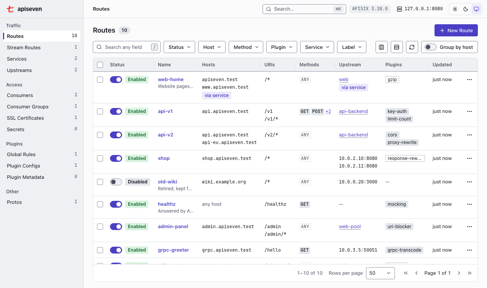
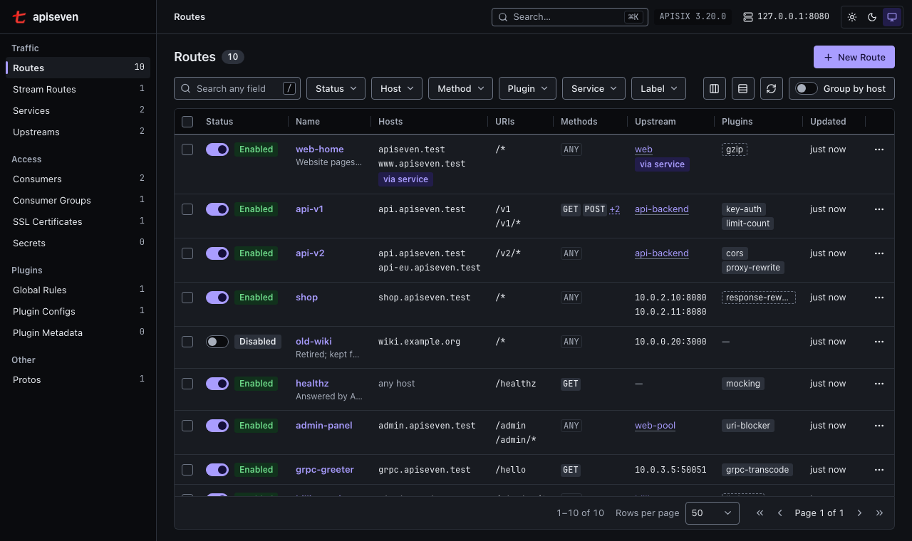
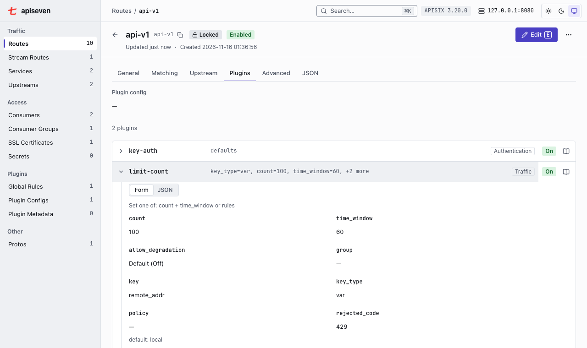
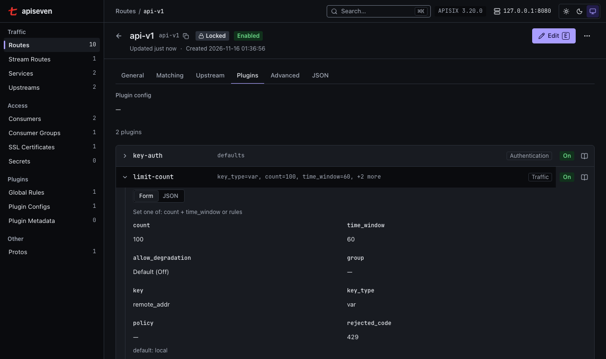

<p align="center">
  
</p>

# apiseven

apiseven is a web dashboard for [Apache APISIX](https://apisix.apache.org/) 3.x. It works only
through the APISIX Admin API: it reads and writes routes, services, upstreams and the rest, the
same objects you would `curl`. Run it as one HTML file that you open from disk, as a folder of
static files, or as a small Docker image that also proxies the Admin API.

apiseven is an independent project. It is not part of Apache APISIX and is not endorsed by the
Apache Software Foundation.

## Why

APISIX ships a dashboard at `/ui` on the Admin API port. On a gateway with many routes it is hard
to work with: the routes page cannot be sorted and you cannot choose its columns, a lot of the
text is grey on grey, and each edit page is one very long form. apiseven is a second dashboard for
the same Admin API, built to fix those things.

## What it does

- **Every Admin API resource:** routes, stream routes, services, upstreams, consumers and their
  credentials, consumer groups, SSL certificates, secrets, global rules, plugin configs, plugin
  metadata and protos. Each can be listed, created, edited and deleted.
- **A routes list you can work with:** sort by any column, choose and reorder the columns
  (host, URI, methods, upstream, service, plugins, status, priority, labels, updated time, ID and
  more), search every field, filter by status, host, method, plugin, service or label, group by
  host, and enable, disable or delete many routes at once.
- **Short edit pages:** every editor is split into tabs, and a stored object opens locked, at
  full contrast. Press Edit to change it.
- **Plugin forms built from the schemas your APISIX reports,** so plugins added in a newer APISIX
  get a form too. Each plugin config is checked in the browser before it is saved; APISIX's own
  check on save has the final word.
- **A JSON tab on every editor.** Fields that no form shows are kept when you save from the form.
- **Search everything** with the command palette (⌘K or Ctrl K).
- **Light and dark themes.** Body and secondary text meet WCAG AA contrast (4.5:1) in both.
- **Several APISIX instances:** save connections (for example staging and production) and switch
  between them. A key can be kept for one browser tab only.
- **A viewer key gives a read-only UI.**

## Screenshots

The routes list:




A route, with a plugin's form open:




## Three ways to run it

| | Single file | Static folder | Docker |
|---|---|---|---|
| What you get | `apiseven.html` | the files of `web/dist` | the `apiseven:local` image |
| Who calls the Admin API | your browser | your browser | the apiseven server |
| Where the admin key lives | your browser | your browser | your browser, or the server |
| APISIX must allow | your browser's IP | your browser's IP | the container's IP |

Nothing is published to a registry yet: you build each of these from this repository. You need
Node.js 22 for the web builds and Docker for the image (`make` targets are listed under
[Development](#development)). On a fresh checkout, the first `make` target that builds the web app
installs its dependencies first (`cd web && npm ci`).

## Quick start: single file

```sh
make single          # writes dist/apiseven.html
```

Open `dist/apiseven.html` in your browser (double-click it; it works from `file://`, and from any
web server too). Enter the Admin API address, such as `http://127.0.0.1:9180`, and an admin key
(see [Admin keys](#admin-keys)).
apiseven checks them with one small request, then saves the connection in this browser.

The file holds everything (scripts, styles, icons), about 1.8 MB, and loads nothing else. Your
browser talks to the Admin API directly, so APISIX must allow it; see
[What APISIX must allow](#what-apisix-must-allow-for-the-browser-modes).

## Quick start: static folder

```sh
make static          # writes dist/apiseven-static.zip (and dist/apiseven.html)
```

Unzip `apiseven-static.zip` into any web server's directory, at any path (it uses relative URLs
and hash routing, so it needs no rewrite rules). Open it and connect as above. The page first asks
for `config.json` next to itself to find out whether apiseven's own server is behind it; on a plain
file server that request answers 404, which is expected.

## Admin keys

apiseven has no users of its own: it acts with an APISIX admin key. The keys are in APISIX's
`config.yaml`; each has a role, `admin` (read and write) or `viewer` (read only, which apiseven
shows as a read-only UI):

```yaml
deployment:
  admin:
    admin_key_required: true    # the default
    admin_key:
      - name: admin
        key: 0f4c2b9e7d1a6c35e8b04f92a7d3c618   # a long random string: openssl rand -hex 16
        role: admin
      - name: viewer
        key: 9b27e04d5c13f8a6b0e49d72c5f18a3e
        role: viewer
    admin_api_version: v3       # the default; apiseven needs it (see Supported APISIX versions)
```

Restart APISIX after changing `config.yaml`. The keys above are examples: make your own.

## What APISIX must allow (for the browser modes)

In the single-file and static modes the browser calls the Admin API itself. In APISIX's
`config.yaml`:

```yaml
deployment:
  admin:
    enable_admin_cors: true     # the default; it must stay on
    allow_admin:                # the default is 127.0.0.0/24
      - 127.0.0.0/24
      - 192.168.1.0/24          # add the network your browser connects from
    admin_listen:
      ip: 0.0.0.0               # listen beyond loopback if the browser is on another machine
      port: 9180
```

- `allow_admin` is checked against the address APISIX sees: the browser's own machine, not a
  server. With APISIX in Docker, published ports often make requests appear to come from the
  Docker gateway rather than from `127.0.0.1`.
- `enable_admin_cors` must stay `true`: it is what lets a page from another origin (including a
  `file://` page) read the Admin API's answers.
- A page served over `https://` cannot call an `http://` Admin API: browsers block mixed content.
  Serve the static folder over `http://`, open the single file from disk, or put the Admin API
  behind HTTPS too.

## Quick start: Docker

The image serves the app and proxies `/apisix/admin` to APISIX, so the browser talks only to
apiseven, and only the container needs to be in `allow_admin`.

```sh
make docker          # docker build -t apiseven:local .
```

### The key in the browser (the default)

```sh
docker run --rm -p 127.0.0.1:8080:8080 --read-only --cap-drop ALL \
  --security-opt no-new-privileges:true \
  --network apisix_default \
  -e APISIX_ADMIN_URL=http://apisix:9180 \
  apiseven:local
```

Open <http://127.0.0.1:8080>. apiseven asks only for the admin key ([Admin keys](#admin-keys));
the server passes it to APISIX with each request and never stores or logs it.

### The key on the server, with Basic auth

```sh
docker run --rm -p 127.0.0.1:8080:8080 --read-only --cap-drop ALL \
  --security-opt no-new-privileges:true \
  --network apisix_default \
  -e APISIX_ADMIN_URL=http://apisix:9180 \
  -e APISIX_ADMIN_KEY_FILE=/run/secrets/apisix_admin_key \
  -v "$PWD/apisix_admin_key.txt:/run/secrets/apisix_admin_key:ro" \
  -e BASIC_AUTH_USER=admin \
  -e BASIC_AUTH_PASSWORD_FILE=/run/secrets/apiseven_password \
  -v "$PWD/apiseven_password.txt:/run/secrets/apiseven_password:ro" \
  apiseven:local
```

With `APISIX_ADMIN_KEY` (or `APISIX_ADMIN_KEY_FILE`) set, the server adds the key to every request
and the browser asks for nothing, so anyone who can open the page has full Admin API access.
Put Basic auth (or your own authentication) in front of it. Without Basic auth the server logs a
`WARNING` at start. With Basic auth on, the browser shows the tab icon only after you sign in.

The image runs as UID 65532, so the two files must be readable by that user: `chmod 0444` them,
or `chown 65532` them and keep `0400`. On Linux, a `0600` file of your own is unreadable through
the mount, and apiseven stops with "APISIX_ADMIN_KEY_FILE: the file it names cannot be read as UID
65532: permission denied" (Docker on macOS maps the file's owner, so there such a file is
readable).

### Joining APISIX's network

`APISIX_ADMIN_URL` is the Admin API as the container reaches it. When APISIX runs in Docker,
attach apiseven to its network (`docker network ls` lists them; a compose project `apisix` has
`apisix_default`) and use the service name, such as `http://apisix:9180`. Then:

- APISIX's `admin_listen.ip` must not be `127.0.0.1` (the default `0.0.0.0` is fine).
- `allow_admin` must include the container's address. `docker network inspect apisix_default`
  shows the network's subnet, such as `172.18.0.0/16`; add that.

If APISIX's Admin API is unreachable, proxied requests answer `502` with a message naming the
address and the error, and the app says "APISIX can't be reached from the apiseven server" with
that message.

### An `https://` Admin API

With an `https://` `APISIX_ADMIN_URL`, apiseven checks APISIX's certificate against the image's CA
bundle and the host name in the URL; the check cannot be switched off. APISIX's `https_admin`
usually has a certificate from a private CA: mount that CA's certificate and point `SSL_CERT_FILE`
at it (the file may hold just that CA):

```sh
  -v "$PWD/apisix-ca.pem:/etc/apiseven/apisix-ca.pem:ro" \
  -e SSL_CERT_FILE=/etc/apiseven/apisix-ca.pem \
  -e APISIX_ADMIN_URL=https://apisix:9180 \
```

The certificate must name the host in `APISIX_ADMIN_URL` (here `apisix`). apiseven presents no
client certificate, so an Admin API that requires one (`admin_api_mtls.admin_ssl_ca_cert`) is not
supported.

### With compose

[`compose.yaml`](compose.yaml) runs the image with a read-only root file system, no capabilities,
`no-new-privileges`, the port bound to `127.0.0.1:8080`, and the built-in health check. Its
comments show both key modes, Basic auth, secrets files and joining an external network.

```sh
docker compose up -d
```

### Behind a reverse proxy

To serve apiseven under a name, for example `https://apisix-admin.example.com`:

- Pass the `Host` header through unchanged. With nginx:

  ```nginx
  location / {
      proxy_pass http://127.0.0.1:8080;
      proxy_set_header Host $http_host;
  }
  ```

  nginx's default sends the upstream's own address instead. apiseven then refuses saves (the app
  says "The apiseven server refused this request: … refused a request from another origin"),
  because the page's origin no longer matches the `Host`, and its host name check (below) sees
  only that address, so it cannot stop DNS rebinding.
- Without Basic auth, set `ALLOWED_HOSTS=apisix-admin.example.com`: by default apiseven answers
  only requests for IP addresses and `localhost`.
- apiseven serves plain HTTP. Use HTTPS in front of it whenever the page is not on `localhost`:
  Basic auth credentials and admin keys are readable on an unencrypted network.

## Configuration

The server reads these environment variables once at start. A missing or malformed value stops it
with a message naming the variable.

| Variable | Meaning |
|---|---|
| `APISIX_ADMIN_URL` | Required. The Admin API, for example `http://apisix:9180` (`http` or `https`; a trailing `/apisix/admin` is accepted and dropped). |
| `APISIX_ADMIN_KEY` | Optional. If set, the server sends this key with every request (replacing any key the browser sends) and the browser asks for none. If unset, the browser asks for a key and the server passes it through. |
| `APISIX_ADMIN_KEY_FILE` | Optional. The absolute path of a file holding the key, such as `/run/secrets/apisix_admin_key`; wins over `APISIX_ADMIN_KEY`. Surrounding white space is trimmed; a relative path, or an empty or unreadable file, is an error. |
| `LISTEN` | The address to listen on. Default `:8080`. |
| `BASIC_AUTH_USER` | Optional. With a password, HTTP Basic auth in front of everything but `/healthz`. |
| `BASIC_AUTH_PASSWORD` | The Basic auth password. Setting only one of user and password is an error. |
| `BASIC_AUTH_PASSWORD_FILE` | The absolute path of a file holding the password; wins over `BASIC_AUTH_PASSWORD`. Trimmed and checked like the key file. |
| `ALLOWED_HOSTS` | Optional. Comma-separated host names (no scheme, no port) apiseven may be opened under, besides IP addresses and `localhost`. `*` turns the check off. Not needed with Basic auth. |
| `HTTP_PROXY`, `HTTPS_PROXY`, `NO_PROXY` | Ignored on purpose: apiseven always connects to `APISIX_ADMIN_URL` directly, never through a forward proxy (Docker can set these in every container). |
| `SSL_CERT_FILE` | Optional. A CA certificate (PEM) to trust for an `https://` Admin API; see [An `https://` Admin API](#an-https-admin-api). |

Errors about a variable name it and say what is wrong, but never repeat a key, a password, or
anything in a URL beyond `scheme://host:port`. Nor do they repeat the value of a `_FILE` variable,
not even the path: a secret pasted there by mistake can look like one. The error names the variable
and says why: the file it names does not exist, cannot be read as UID 65532, or is empty.

The server answers:

- `/`, and the app's files: the web app.
- `/config.json`: `{"adminBase":"apisix/admin","keyRequired":true}`, which tells the app it is
  behind apiseven's server and whether to ask for a key.
- `/apisix/admin` and everything under it: the Admin API proxy (`GET`, `HEAD`, `POST`, `PUT`,
  `PATCH`, `DELETE`, `OPTIONS`; bodies up to 16 MiB). Every request must carry the header
  `X-Apiseven-Request: 1`, which the app sends and other web pages cannot (see
  [Security notes](#security-notes)). From a script:

  ```sh
  # key on the server
  curl -H 'X-Apiseven-Request: 1' http://127.0.0.1:8080/apisix/admin/routes
  # key in the browser mode: send the key too
  curl -H 'X-Apiseven-Request: 1' -H 'X-API-KEY: <admin key>' http://127.0.0.1:8080/apisix/admin/routes
  ```

  With Basic auth on, add `-u <user>:<password>` to either command; without it the server answers
  `401` (`apiseven: sign-in required`).

  Answers the server makes itself (a refused request, or `502` when APISIX cannot be reached)
  carry `X-Apiseven-Refusal` with a one-word reason (`header`, `origin`, `host`, `auth`, `path`,
  `method`, `size`, `request` when the request body could not be read, `upstream`) and a JSON
  `error_msg`; APISIX's own answers pass through without it.
- `/healthz`: `ok`, without authentication. `apiseven -healthcheck` requests it from the server at
  `LISTEN` and exits 0 when healthy; the image and `compose.yaml` use it as the health check.

It logs one line per request (method, path, status, duration, client address) to standard
output, except for `/healthz`. When a request body cannot be read, it also logs the path and a
one-word reason (`timeout`, `truncated` or `malformed`), never the parser's message, which can quote
the client's data.

## Security notes

- **Where the key lives.** Single file and static folder: in your browser's local storage, or for
  the current tab only if you untick "Remember the key"; requests go straight from the browser to
  APISIX. Docker without a server key: the same, and the server only passes the key on. Docker
  with a server key: in the container's environment or secret file; it never reaches the browser.
- **The server-key mode without Basic auth gives full Admin API access to anyone who can open the
  page.** Keep the port on `127.0.0.1` (as `compose.yaml` does), or set `BASIC_AUTH_*`.
- **A viewer key gives a read-only UI.** APISIX refuses its writes; apiseven notices at the first
  refused write and shows the connection as read-only until the page is reloaded.
- **Other web pages cannot use the proxy.** It requires a custom header that a page on another
  origin cannot send without permission the server never gives, and it refuses requests whose
  `Origin` names another host or port, or whose `Sec-Fetch-Site` is `cross-site` or `same-site`
  (a sibling subdomain is another origin too). It also answers only requests for IP addresses,
  `localhost` and the names in `ALLOWED_HOSTS` (any name once Basic auth is on), so an attacker's
  domain that resolves to your apiseven (DNS rebinding) gets nothing.
- **What reaches APISIX and the logs.** The browser's `Authorization` (Basic auth) and cookies are
  never forwarded to APISIX, and the connection to APISIX never goes through `HTTP_PROXY`. The
  server never logs or prints keys, credentials, query strings or request bodies, not even in an
  error about a malformed setting.
- **Content Security Policy (Docker mode).** Every response from apiseven's server carries:

  ```
  default-src 'self'; script-src 'self' 'unsafe-eval'; style-src 'self' 'unsafe-inline';
  img-src 'self' data:; font-src 'self' data:; connect-src 'self'; manifest-src 'self';
  frame-ancestors 'none'; base-uri 'self'; form-action 'self'
  ```

  - `script-src 'self' 'unsafe-eval'`: scripts load only from apiseven's own origin; inline and
    foreign scripts are blocked. `'unsafe-eval'` lets scripts already running in the page turn
    text into code (`eval`, `new Function`). It is there because the form validator (Ajv)
    compiles each JSON schema your APISIX reports into a function, in the browser; without it the
    plugin forms lose their checks and their conditional fields.
  - `style-src 'self' 'unsafe-inline'`: stylesheets from apiseven's origin, and any inline style
    (style elements and attributes), which the code editor and the app's components set.
  - `connect-src 'self'`: the page may connect only to apiseven itself; in Docker mode it never
    calls APISIX directly.
  - Images and fonts come from apiseven or `data:` URLs; no site may frame the page.
- **The static folder and the single file have no such header at all:** no server of apiseven's
  sends them headers (the static folder gets whatever your web server adds). The single file's
  scripts are inline. It holds no key; the key you type stays in that browser.

## Supported APISIX versions

Developed and tested against APISIX 3.20 with the etcd-backed Admin API (the `traditional`
deployment role). Older 3.x releases should mostly work: resource types an APISIX does not have
are detected and hidden. APISIX 2.x and the standalone (YAML) mode are not supported.

apiseven needs the Admin API's v3 format, which is APISIX 3.20's default:
`deployment.admin.admin_api_version: v3`. With any other value (such as `v2`), APISIX answers in
the old format, with each object wrapped in `node` and a list in `node.nodes`. apiseven cannot
read that: the Connect page says "APISIX answered in the Admin API's v2 format", and the other pages
name the setting. Set it to `v3`, or remove the line, then restart APISIX. APISIX names the format
it uses in the `X-API-VERSION` header of each answer:

```sh
curl -si -H 'X-API-KEY: <admin key>' http://127.0.0.1:9180/apisix/admin/routes | grep -i '^x-api-version'
```

## Status

What is covered: every resource type of the 3.20 Admin API, with lists, tabbed editors, plugin
forms, a JSON tab and the command palette, and the three ways to run it described above.

Known limitations:

- Only what the Admin API offers: no metrics, logs or traffic data, no editing of APISIX's own
  `config.yaml`, no user accounts (access is whatever the admin key allows).
- Everything is loaded into the browser, which suits up to a few thousand objects per type.
- A viewer key is recognised only when a write is refused.
- The browser's checks of plugin configs cover what JSON Schema can express; some of APISIX's own
  checks run only when you save.
- In Docker mode the Content Security Policy allows `'unsafe-eval'`, for the form validator (see
  [Security notes](#security-notes)). Dropping it needs a validator that checks schemas without
  generating code.

## Development

You need Node.js 22, Go 1.27 and Docker.

```sh
make dev-up     # APISIX 3.20 + etcd from dev/compose.yaml (the file says which host ports it uses)
make seed       # sample routes, upstreams, consumers, SSL, ... (node dev/seed.mjs; --reset wipes first)
make web        # the Vite dev server (cd web && npm run dev); connect to the dev Admin API
make check      # web: type check, lint, unit tests; server: gofmt, go vet, go test
make dev-down   # stop the dev stack and drop its data
```

Every `make` target that runs npm (`web`, `check`, `test`, `build`, `single`, `static`) first
runs `cd web && npm ci` when `web/node_modules` is missing; an existing install is left as it is.
Run `cd web && npm ci` yourself after a pull that changes `web/package-lock.json`, and before you
use `npm` or `npx` in `web/` directly.

The dev APISIX uses the admin key `apiseven-dev-admin-key` (and `apiseven-dev-viewer-key` for a
viewer), from `dev/apisix-config.yaml`; these are public test values. `make web` cannot use the
server's proxy; it is the static mode, so connect with the Admin API address from
`dev/compose.yaml` and the dev key.

Tests marked `.live.test.ts` run against a real APISIX and are skipped unless `APISIX_LIVE=1`:

```sh
cd web && APISIX_LIVE=1 npx vitest run src/api/client.live.test.ts
```

They read `APISIX_ADMIN_URL` and `APISIX_ADMIN_KEY` (defaults: the dev stack) and remove what they
create.

Other targets: `make build` (the server with the web app embedded, at `bin/apiseven`),
`make docker` (the image `apiseven:local`), `make single` and `make static` (the exports in
`dist/`), `make test` (the tests, without the type check and lint).

## Project layout

```
web/               the app: React, TypeScript, Vite
  src/             its source and unit tests
  public/          icons and the web manifest
  vite.config.ts   the normal build (web/dist)
  vite.single.config.ts, singleFile.ts   the single-file build (web/dist-single/apiseven.html)
server/            the Go server (standard library only): static files, config.json, the proxy
  dist/            the web build embedded at compile time (copied in by make build or Docker)
dev/               the dev APISIX (compose.yaml, apisix-config.yaml), seed data, generators
docs/              the design and plans, and the README's screenshots
Dockerfile, compose.yaml, Makefile
```

## License

Apache License 2.0; see [LICENSE](LICENSE). The plugin descriptions and categories come from the
Apache APISIX documentation; see [NOTICE](NOTICE).
